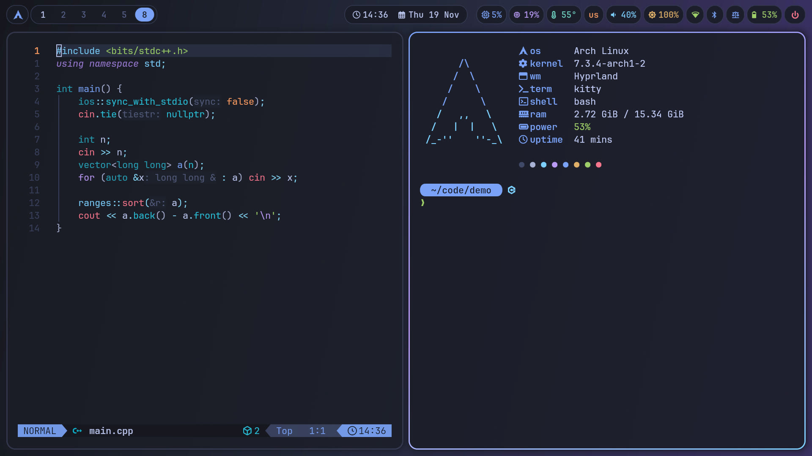
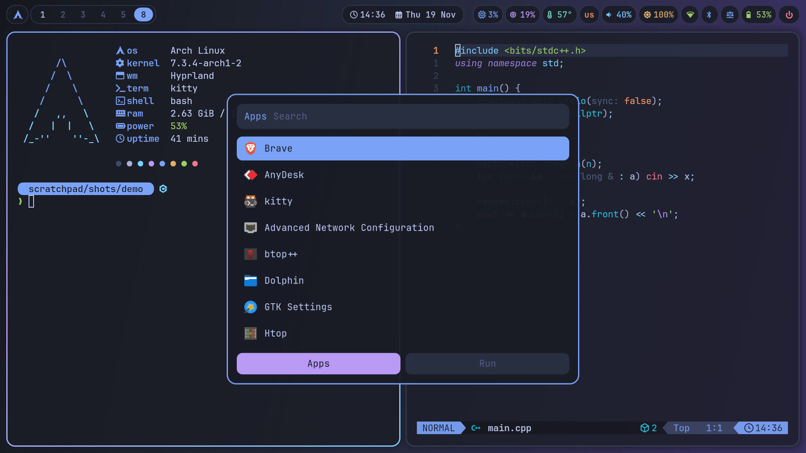
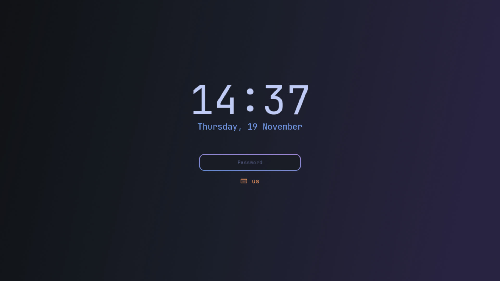
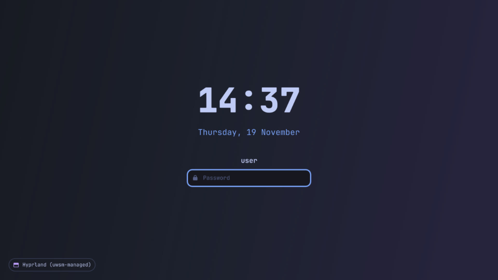

# Neon Arch

A beginner-friendly Arch Linux desktop with **Hyprland** and a **Tokyo Night** theme,
explained step by step.

This repository holds my real config files plus notes on how everything works.
You can copy the whole setup or just learn from the parts you like.

> **Read before you install.** These files change how your desktop works. Read
> [`install.sh`](install.sh) before running it. It asks before every step and
> backs up your existing files, but you should still know what it does.

## Quick start

**New to Arch? Follow the [step-by-step guide](docs/00-start-here.md).** It goes
from a blank laptop to the finished desktop.

Already have a fresh archinstall Hyprland system? This one command installs
everything:

```bash
sudo pacman -S --needed git && git clone https://github.com/DAGMON-Z/neon-arch.git ~/neon-arch && bash ~/neon-arch/install.sh --all
```

To see what it would do first, without changing anything, run the installer
with `--dry-run`. The [guide](docs/00-start-here.md#part-4-install-neon-arch)
explains the options.

**Already installed? Update** to the newest version with one command:

```bash
git -C ~/neon-arch pull --ff-only && bash ~/neon-arch/install.sh --update
```

See [Getting updates](#getting-updates) for what it does.

## Table of contents

0. [**Start here: step-by-step guide**](docs/00-start-here.md)
1. [Installing Arch with archinstall](docs/01-install.md)
2. [Packages and what they do](docs/02-packages.md)
3. [Hyprland](docs/03-hyprland.md)
4. [Waybar (the top bar)](docs/04-waybar.md)
5. [kitty, rofi and dunst](docs/05-kitty-rofi-dunst.md)
6. [Lock screen and idle](docs/06-lockscreen.md)
7. [Wallpaper and `set-wallpaper`](docs/07-wallpaper.md)
8. [GTK and Qt theming](docs/08-gtk-qt-theming.md)
9. [Neovim with LazyVim](docs/09-neovim.md)
10. [Boot menu and login screen themes](docs/10-boot-and-login-themes.md)
11. [Troubleshooting: problems I hit](docs/11-troubleshooting.md)
12. [Power management](docs/12-power-management.md)
13. [Secure Boot (optional)](docs/13-secure-boot.md)
14. [Files and downloads: Thunar and Persepolis](docs/14-files-and-downloads.md)
15. [The terminal shell: zsh with VS Code keys](docs/15-terminal-shell.md)
16. [My personal apps](docs/16-personal-apps.md)
17. [SSH: control another computer](docs/17-ssh.md)
18. [BEMO: a desk buddy for working and studying](docs/18-bemo.md)

## Screenshots

**Desktop:** Waybar on top, Neovim with C++ on the left, kitty with fastfetch
and the starship prompt on the right.



**App launcher:** rofi in Apps mode (click the Arch logo on the bar).



| Lock screen (hyprlock) | Login screen (SDDM) |
| --- | --- |
|  |  |

The screenshots use a plain gradient; a fresh install uses the included sci-fi
city wallpaper. Change it any time with
[`set-wallpaper`](docs/07-wallpaper.md). There's no screenshot of the boot menu,
because GRUB can't be captured from inside Linux. More details are in
[docs/screenshots](docs/screenshots/README.md).

## What's inside

| Component | What it does | Config |
| --- | --- | --- |
| Hyprland (Lua config) | The window manager: windows, gaps, borders, animations, keybinds | `home/.config/hypr/hyprland.lua` |
| Waybar | Top bar with workspaces, clock, system info and a power menu | `home/.config/waybar/` |
| kitty | Terminal | `home/.config/kitty/` |
| rofi | Command runner and app launcher | `home/.config/rofi/` |
| Thunar | File manager | `home/.config/Thunar/` |
| Persepolis | Download manager | `home/.config/persepolis_download_manager/` |
| dunst | Notifications and the volume and brightness popup | `home/.config/dunst/` |
| hyprlock | Lock screen | `home/.config/hypr/hyprlock.conf` |
| hypridle | Nothing happens when idle (no auto lock or suspend); locks before any suspend | `home/.config/hypr/hypridle.conf` |
| awww | Wallpaper with smooth transitions | `home/.local/bin/set-wallpaper` |
| SDDM and GRUB themes | Login screen and boot menu | `home/.local/share/rice-boot-themes/` |
| GTK and Qt theming | Dark apps with Papirus icons | `home/.config/gtk-3.0/`, `gtk-4.0/`, `qt6ct/`, `kdeglobals` |
| Neovim and LazyVim | Code editor with C++ support | `home/.config/nvim/` |
| zsh | Terminal shell: select, copy, cut, paste, undo and redo like VS Code | `home/.zshrc` |
| starship | Shell prompt | `home/.config/starship.toml` |
| fastfetch | System summary in new terminals | `home/.config/fastfetch/` |
| Power management | Power modes, Intel cooling, power-saver on battery | `system/usr/local/bin/power-profile-auto` |
| BEMO | Desk buddy: codes when you work, reads when you study, sleeps when you're away, shares your coffee | `home/.local/bin/bemo` |

The `home/` folder mirrors your home folder. For example,
`home/.config/kitty/kitty.conf` goes to `~/.config/kitty/kitty.conf`.

Some files contain `@HOME@`. That stands for your home folder, and `install.sh`
replaces it with your real path.

### Hardware-specific files

> **Warning:** `system/` contains a touchpad fix written for **one laptop
> model, the MSI Modern 15 F13MG**. It restarts a specific hardware controller at
> boot. Do not install it on other computers unless you have the same problem and
> understand the fix. See [troubleshooting](docs/11-troubleshooting.md#touchpad-error--110).

The automatic power-saver files in `system/` are different: they work on most
laptops. See [power management](docs/12-power-management.md).

## Keybinds cheat sheet

`SUPER` is the Windows key.

| Keys | Action |
| --- | --- |
| `SUPER + Q` | Open terminal (kitty) |
| `SUPER + R` | Run a command (rofi in Run mode) |
| Click the Arch logo on the bar | App launcher with icons (rofi in Apps mode) |
| `SUPER + E` | File manager (Thunar) |
| `SUPER + C` | Close window |
| `SUPER + SHIFT + Q` | Force-close a frozen window (kills its program) |
| `CTRL + SHIFT + Esc` | Task manager: see running apps and end them (Mission Center) |
| `Calculator` key | Scientific calculator (GNOME Calculator; also in the app launcher) |
| `SUPER + F` | Maximize or restore |
| `SUPER + SHIFT + F` | Fullscreen or restore |
| `SUPER + V` | Float or tile window |
| `SUPER + P` | Pseudo-tile window |
| `SUPER + J` | Switch split direction |
| `SUPER + arrow keys` | Move focus |
| `SUPER + 1` to `0` | Go to workspace 1 to 10 |
| `SUPER + SHIFT + 1` to `0` | Move window to workspace 1 to 10 |
| `SUPER + mouse scroll` | Next or previous workspace |
| `SUPER + left drag` | Move window |
| `SUPER + right drag` | Resize window |
| `SUPER + S` | Hide the window (like minimizing). Press again to bring it back |
| Three-finger swipe | Switch workspace |
| `Print` | Screenshot of the whole screen, only copied (paste with `Ctrl + V`), not saved |
| `SHIFT + Print` | Screenshot of an area, only copied, not saved |
| `SUPER + Print` | Screenshot of the whole screen, saved to `~/Pictures/Screenshots` and copied |
| `SUPER + SHIFT + Print` | Screenshot of an area, saved and copied |
| `SUPER + SHIFT + C` | Start or finish a coffee with [BEMO](docs/18-bemo.md) |
| Volume and brightness keys | Change level, with an on-screen popup |
| `Alt + Shift` | Switch keyboard layout (English and Arabic) |
| `SUPER + L` | Lock the screen (unlock with your password) |
| `SUPER + M` | **Log out right away** (closes all apps) |

## Install

The [step-by-step guide](docs/00-start-here.md) covers this in detail. In short:

1. Install Arch first. See [docs/01-install.md](docs/01-install.md).
2. Get this repository:

   ```bash
   sudo pacman -S --needed git
   git clone https://github.com/DAGMON-Z/neon-arch.git ~/neon-arch
   cd ~/neon-arch
   ```

3. **Read `install.sh`**, for example with `less install.sh`. Press `q` to quit.
   The packages it installs are listed in [`packages.txt`](packages.txt) and
   [`aur-packages.txt`](aur-packages.txt). See [docs/02-packages.md](docs/02-packages.md).
4. Run it as your normal user, not with `sudo`. It asks for your password when it
   needs it.

   ```bash
   bash install.sh --dry-run   # only shows what it would do
   bash install.sh             # asks before every step
   bash install.sh --all       # does every general step without asking
   ```

   `--all` skips the AUR apps and the MSI touchpad fix. Add
   `--wallpaper <image>` to set your wallpaper at the same time, and
   `--scale 1.25` to make everything 125% size.

5. The installer sets the included sci-fi city wallpaper everywhere. To use your
   own image instead:

   ```bash
   set-wallpaper ~/Pictures/Wallpapers/your-image.jpg
   ```

6. Restart and log in. The session pill at the bottom left of the login screen
   should say **Hyprland (uwsm-managed)**. Click it to switch if it doesn't.
7. After logging in, run `hyprland-welcome` in a terminal. Every item should be
   green or blue.

## Getting updates

When this repository changes, one command updates an installed computer:

```bash
git -C ~/neon-arch pull --ff-only && bash ~/neon-arch/install.sh --update
```

> **Installed it when it was called Arch Style?** Your old update command
> (`git -C ~/arch-style pull ...`) still works. The first update moves the folder
> to `~/neon-arch` and leaves `~/arch-style` as a link to it, so both names work.

`git -C ~/neon-arch pull --ff-only` downloads the latest version first, so this
works even if your copy is older than the `--update` option. `&&` runs the
update only if the download worked.

It downloads the latest version and installs any new packages. It also copies
changed config files (backing up the old ones), turns on any new services, and
reloads Hyprland, Waybar and dunst, and starts BEMO. Your wallpaper stays as it is. It asks for
your password only if something needs administrator rights. Add `--dry-run` to
see what it would do first.

- If you're still using bash, it asks whether to switch to zsh for the VS Code
  style terminal keys. Answer **y**, then log out and back in.
- Close and reopen apps (Neovim, kitty and so on) to use their new settings.
- Restart if it updated system files, such as the touchpad fix or the login
  screen.

## Keeping your own copy up to date

If you fork this repository for your own configs, `sync.sh` copies your current
files back into it:

```bash
cd ~/neon-arch
./sync.sh
git status
git add .
git commit -m "Describe what changed"
git push
```

`sync.sh` skips `.bak` files, replaces your home folder path with `@HOME@`, and
stops if a file looks like it contains a password or token. That check catches
common patterns, not every secret, so look at `git diff` before you push.

## Credits

This setup is built on the work of these projects:

- Window manager and tools: [Hyprland](https://github.com/hyprwm/Hyprland),
  [hyprlock](https://github.com/hyprwm/hyprlock),
  [hypridle](https://github.com/hyprwm/hypridle),
  [hyprpaper](https://github.com/hyprwm/hyprpaper),
  [uwsm](https://github.com/Vladimir-csp/uwsm)
- Desktop: [Waybar](https://github.com/Alexays/Waybar),
  [kitty](https://github.com/kovidgoyal/kitty),
  [rofi](https://davatorium.github.io/rofi),
  [dunst](https://dunst-project.org/),
  [awww](https://codeberg.org/LGFae/awww),
  [grim](https://gitlab.freedesktop.org/emersion/grim),
  [slurp](https://github.com/emersion/slurp),
  [cliphist](https://github.com/sentriz/cliphist),
  [brightnessctl](https://github.com/Hummer12007/brightnessctl)
- Colors: [Tokyo Night](https://github.com/enkia/tokyo-night-vscode-theme) by
  enkia, and the [tokyonight.nvim](https://github.com/folke/tokyonight.nvim) palette by folke
- Themes and fonts: [adw-gtk3](https://github.com/lassekongo83/adw-gtk3),
  [Papirus icons](https://github.com/PapirusDevelopmentTeam/papirus-icon-theme),
  [Capitaine cursors](https://github.com/keeferrourke/capitaine-cursors),
  [Nerd Fonts](https://github.com/ryanoasis/nerd-fonts) (JetBrains Mono),
  [qt6ct](https://www.opencode.net/trialuser/qt6ct)
- Editor and shell: [Neovim](https://neovim.io),
  [LazyVim](https://github.com/LazyVim/LazyVim) and its
  [starter](https://github.com/LazyVim/starter),
  [starship](https://starship.rs/),
  [competitest.nvim](https://github.com/xeluxee/competitest.nvim) with
  [Competitive Companion](https://github.com/jmerle/competitive-companion),
  [fastfetch](https://github.com/fastfetch-cli/fastfetch)
- Boot and login: [SDDM](https://github.com/sddm/sddm),
  [GRUB](https://www.gnu.org/software/grub/)
- Installer: [archinstall](https://github.com/archlinux/archinstall)
- Default wallpaper: a sci-fi city artwork whose original artist I couldn't
  find. If you made it, please open an issue so I can credit you, or remove it
  if you prefer.

## License

My configs and scripts are under the [MIT License](LICENSE). Parts that come
from other projects keep their own licenses. For example, the Neovim config
starts from the LazyVim starter, which is Apache 2.0 (see
`home/.config/nvim/LICENSE`).

## My personal apps (one command)

The apps I use every day: VS Code, Telegram, WhatsApp, Notion, Microsoft Teams,
Discord, Brave, Chrome, Outlook, AnyDesk, VLC, Claude Code, Claude Desktop,
Spotify, LibreOffice, Git, Zoom, and VirtualBox with its Extension Pack.

```bash
sudo pacman -S --needed git && { [ -d ~/neon-arch ] || git clone https://github.com/DAGMON-Z/neon-arch.git ~/neon-arch; } && bash ~/neon-arch/apps.sh
```

- `sudo pacman -S --needed git` installs git, if it's missing.
- `[ -d ~/neon-arch ] || git clone ...` downloads this repository, unless you
  already have it. `[ -d folder ]` checks whether a folder exists, and `||`
  runs the next part only if it doesn't.
- `bash ~/neon-arch/apps.sh` shows the list of apps, asks once, then installs
  everything.

Restart afterwards, so VirtualBox is ready. WhatsApp, Notion and Teams have no
official Linux apps, and Outlook classic is Windows-only, so those use
unofficial apps or the web version. See [docs/16-personal-apps.md](docs/16-personal-apps.md).

