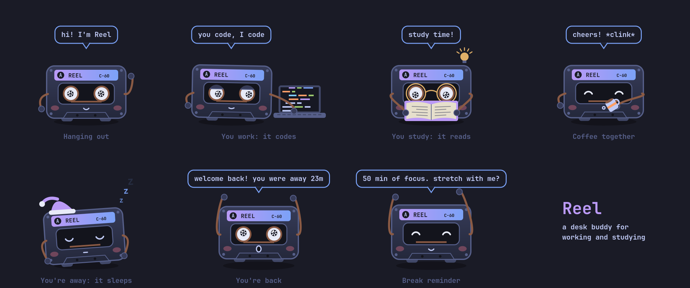

# 18. Reel: a desk buddy for working and studying

Reel is a little cassette tape that lives in the bottom-right corner of the
screen and keeps you company. Its two tape reels are its eyes: they spin fast
while you code, slowly while you read, and stop when it sleeps.



## What it does

| You... | Reel... |
| --- | --- |
| Work (terminal, code editor, GitHub or localhost in the browser) | Types on its own laptop, with code scrolling on the screen |
| Study (PDFs, Obsidian, LibreOffice, browser tabs about a course or lecture) | Puts on glasses and reads a book, turning the pages |
| Have a coffee (`SUPER + SHIFT + C`) | Drinks one too, sipping with its eyes closed |
| Step away for 5 minutes, or lock the screen | Falls asleep in a nightcap |
| Come back | Yawns and tells you how long you were gone |
| Focus for 50 minutes in a row | Stretches and asks you to stretch too (also as a notification) |
| Keep working after midnight | Gently suggests going to sleep |

- **Left-click** Reel to see today's focus time and coffees.
- **Right-click** it to start or finish a coffee.
- **Drag it** with the left mouse button to move it along the bottom of the
  screen. It remembers where you left it.

The bar also shows Reel's face and today's focus time, for example
`[o_o] 1h20m`. The color follows its mood: blue for work, purple for study,
orange for coffee, grey when asleep. Click it for a coffee.

## How it works

Reel is one Python file, `~/.local/bin/reel`. It draws itself with Cairo in a
small transparent GTK layer-shell window, the same kind of surface Waybar uses.

- **Work or study** comes from the focused window. Reel listens to Hyprland's
  event socket, so it reacts instantly without polling. In a browser, the tab
  title decides.
- **Away** comes from a private `hypridle` that Reel starts for itself. It only
  tells Reel when you go idle and come back. It never locks or suspends, and
  your own `hypridle.conf` is not involved. Reel also sleeps while `hyprlock`
  is running. A playing video counts as activity, so Reel stays awake during a
  lecture video.
- **Coffee** can't be detected, so you tell it: `SUPER + SHIFT + C`, a
  right-click, the bar module, or `reel coffee`.

It starts with Hyprland (`hl.exec_cmd("~/.local/bin/reel run")` in
`hyprland.lua`). It needs `gtk-layer-shell`, `python-gobject` and
`python-cairo`, which are in `packages.txt`.

## Commands

```bash
reel run            # start it (Hyprland does this at login)
reel run --demo     # show every mood, 7 seconds each
reel coffee         # start or finish a coffee together
reel away           # put it to sleep;  reel back  wakes it
reel say hello      # make it say something
reel stats          # today's work time, study time and coffees
reel quit           # stop it
```

## Settings

Create `~/.config/reel/config.json` with only the settings you want to change,
then restart Reel with `reel quit` and `reel run &`:

```json
{
    "break_minutes": 25,
    "away_minutes": 10,
    "study_title_words": [".pdf", "lecture", "course", "moodle", "my university"]
}
```

| Setting | Default | Meaning |
| --- | --- | --- |
| `break_minutes` | `50` | Focus time before the stretch reminder (25 gives Pomodoro-style breaks) |
| `away_minutes` | `5` | Time without keyboard or mouse before Reel falls asleep |
| `coffee_minutes` | `15` | A coffee ends by itself after this long |
| `work_classes`, `study_classes` | see the file | Apps that count as work or study (window class patterns such as `jetbrains-*`) |
| `study_title_words`, `work_title_words` | see the file | Words in a browser tab's title that count as study or work |

Replacing a list replaces the whole default list, so copy the defaults from the
top of `~/.local/bin/reel` and add to them. To find an app's window class, focus
it and run `hyprctl activewindow | grep class`.

Stats are kept for 60 days in `~/.local/state/reel/stats.json`.

## Problems

- **Reel doesn't appear:** run `reel run` in a terminal to see the error. A
  missing package shows as `Namespace GtkLayerShell not available`: install
  `gtk-layer-shell`.
- **"reel is already running":** it is. Run `reel quit` first.
- **It never falls asleep:** check that its idle watcher runs with
  `pgrep -a hypridle`. There should be one line ending in `reel-hypridle.conf`
  besides your own `hypridle`. A playing video keeps it awake on purpose.
- **An app counts as the wrong thing:** add its class or title words in the
  settings above.
